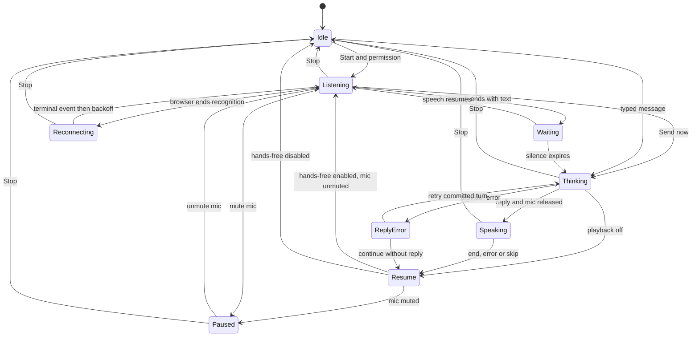

# Architecture

The frontend uses native ES modules. The Node backend serves the UI and exposes `POST /api/chat`.

| Module | Responsibility |
| --- | --- |
| `controller.js` | Hands-free intent, recognizer ownership, silence timer, turn commit, retry and playback orchestration |
| `web-speech-stt.js` | Browser recognition lifecycle, speech activity and cumulative result snapshots |
| `tts.js` | Browser speech synthesis, cancellation and terminal-event timeout |
| `settings.js` and `transcript.js` | Ephemeral credentials and preferences, persisted journal and exports |
| `main.js` and `ui.js` | Event wiring and rendering derived from controller state |
| `server/chat.js` and `server/ai-provider.js` | Input validation, bounded OpenAI requests, safe errors and disconnect handling |

## Capture and turn-taking

Web Speech owns microphone capture. The app observes browser audio lifecycle events and never calls `getUserMedia`. There is no app-owned MediaStream or track state in this adapter. The debug field for the last microphone state describes recognition audio events.

The silence timer measures the pause after detected speech. Browser speech events suppress commits during active speech. Result events provide an activity signal when speech events are unavailable. Every result replaces the current recognizer snapshot, so interim revisions are never concatenated as separate utterances. A recoverable recognition end freezes the last snapshot and preserves any already-running turn timer.

The half-duplex controller pauses recognition as part of the transition to Thinking, including manual sends. It waits for the recognizer's terminal event before TTS and before any new recognizer can start. A missing terminal event produces an error and allows the reply to appear as text. After playback ends, errors, or is skipped, the controller checks hands-free intent and microphone mute before resuming. Short waits between browser sessions and occasional browser permission prompts remain possible.

Recoverable recognition stops use a 250 ms starting backoff, capped at 4 seconds with five consecutive retries. Speech or 15 seconds of stable listening resets the counter. Permission and device failures require user action. Stop invalidates asynchronous work with a session generation and aborts an in-flight request. Session identity and terminal acknowledgement guard late recognition events and rapid Stop/Start.

Each user turn is recorded once before network I/O. The assistant entry shares the same turn ID. A failed or stopped in-flight reply can be retried from the tab using current settings. Retry sends a new provider request and can consume API quota again. Reload preserves the journal while clearing in-memory retry state and settings.

## Streaming upgrade path

A streaming adapter would acquire one MediaStream for the session, feed audio through an AudioWorklet to voice activity detection and a persistent STT transport, and gate audio during assistant playback. That route needs a provider-specific authenticated transport, buffered audio and reconnect policy, plus explicit microphone track and browser suspension handling. The current adapter uses the browser's recognition service and its event timing.
